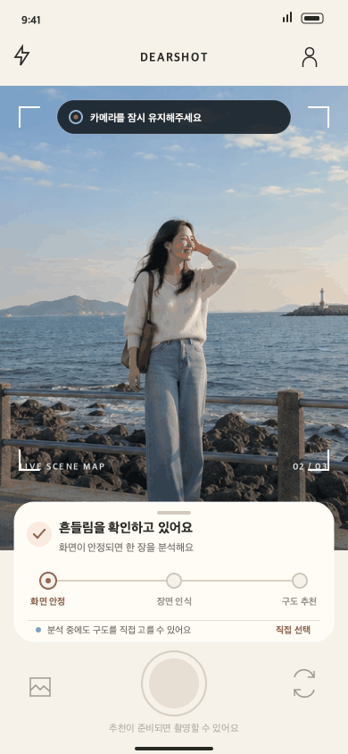
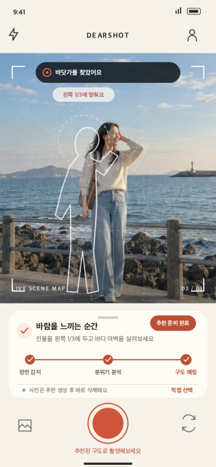
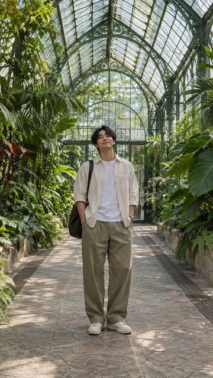
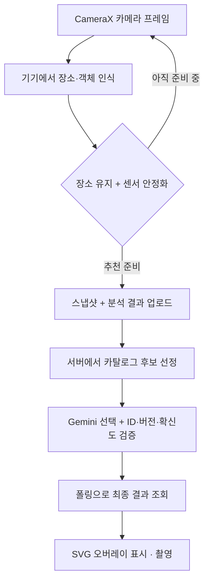

<h1 align="center">DearShot · 디어샷</h1>

<p align="center">
  <strong>어떤 구도로 찍을지 고민되는 순간, 지금 장소에 어울리는 촬영 가이드</strong>
</p>

<p align="center">
  카메라로 장소와 객체를 인식하고, 장면이 안정되면 구도를 자동으로 추천합니다.<br />
  예시 사진과 투명 오버레이를 보며 내 카메라로 직접 촬영하는 Android 앱입니다.
</p>

<p align="center">
  <a href="https://velog.io/@imkara/series/DearShot"></a>
  <a href="https://www.figma.com/proto/SD3LHJwKLaXeezgv16SnTh/DearShot---%EC%B5%9C%EC%A2%85?node-id=4-2&amp;scaling=min-zoom&amp;content-scaling=fixed&amp;page-id=0%3A1"></a>
  <a href="./docs/ARCHITECTURE.md"></a>
</p>

<p align="center">
  
  
  
  
  
  
</p>

---

## Overview

사진을 찍을 장소는 정했지만 **인물을 어디에 두고, 어느 거리와 각도로 찍어야 할지** 막막할 때가 있습니다. 예쁜 예시를 찾아도 실제 카메라 화면에서 그 구도를 따라 하기는 어렵습니다.

DearShot은 **장소 인식 → 구도 추천 → 오버레이 촬영**을 하나의 흐름으로 연결합니다. 장소·객체 인식은 기기에서 수행하고, 추천할 장면이 준비됐을 때만 스냅샷과 분석 결과를 서버로 보냅니다. 서버는 등록된 구도 후보 안에서 Gemini가 선택한 템플릿을 검증해 반환합니다.

> **개인 프로젝트 · 개발 중** — 기획, UI/UX 디자인, Kotlin Android 앱과 TypeScript 백엔드를 함께 개발하고 있습니다. Android 구현을 중심으로 카메라, 온디바이스 ML, 비동기 상태 관리와 사용자 경험을 다룹니다.

## Preview

<p align="center">
  
  &nbsp;&nbsp;
  
</p>

<p align="center"><sub>Figma에 반영한 디자인·모션 참고 자료입니다. Android 실기기 녹화와는 구분됩니다.</sub></p>

카메라 미리보기, 장소·객체 인식, 서버 추천과 SVG 오버레이 연결은 실기기에서 확인했습니다. 현재는 탐색 안내, 스캔 진행 애니메이션과 재분석 흐름을 다듬고 있습니다.

## Key Features

| 기능 | 설명 |
| --- | --- |
| CameraX 촬영 | 카메라 미리보기, 전후면 전환, 플래시, 배율 선택·핀치 줌, 터치 초점과 앱 내부 촬영 파일 저장 |
| 온디바이스 장소 인식 | ResNet18-Places365의 결과를 앱에서 지원하는 장소로 매핑 |
| 온디바이스 객체 인식 | YOLOX-Nano의 검출 결과와 좌표를 카메라 화면에 표시 |
| 자동 추천 시작 | 장소의 연속 인식과 자이로 기반 안정화 상태를 확인한 뒤 추천용 스냅샷 생성 |
| 장면에 맞는 구도 추천 | 이미지와 기기 분석 결과를 서버에 전달하고, 등록된 후보 중 Gemini가 선택한 템플릿 조회 |
| 촬영 오버레이 | 예시 사진에 맞춘 투명 SVG 가이드로 인물 위치와 주변 공간의 배치 안내 |
| 로그인·인증 | 게스트·카카오·Google 로그인, 토큰 저장과 만료 시 공통 갱신 처리 |
| 한국어·영어 | 앱 리소스와 모델 결과의 표시 이름을 한국어·영어로 분리 |

### Composition Catalog

바다·물가, 카페, 녹지, 도시 거리의 기존 세트에 **서점·도서관, 미술관·전시실, 실내 온실**을 추가했습니다. 각 세로 구도 세트는 예시 사진, 썸네일, 투명 SVG와 한국어·영어 촬영 안내로 구성됩니다.

<p align="center">
  
  
  
</p>

<p align="center"><sub>앱 스크린샷이 아닌 AI 생성 구도 예시입니다.</sub></p>

템플릿은 ID와 버전으로 관리합니다. 서버는 후보에 없는 ID·버전을 거부하며, 추천 확신도가 부족하면 직접 선택이 필요한 결과를 반환합니다. 새 세 장소의 서버 후보 조회와 실제 Gemini 선택은 확인했고, 실기기 장소 인식 품질은 계속 검증하고 있습니다.

## How It Works



실시간 카메라 프레임을 계속 서버로 보내지는 않습니다. 기기에서 추천 시작 시점을 판단하고 스냅샷을 확보한 뒤, 업로드 → 분석 작업 생성 → 결과 폴링 → 템플릿 상세 조회를 연결합니다.

## Engineering Decisions

### 1. 기기에서 인식하고, 서버에서 구도를 선택하기

| 구성 | 역할 | 선택 이유 |
| --- | --- | --- |
| ResNet18-Places365 | 장면별 점수 산출 | 장소 분류에 맞춰 학습된 모델의 결과를 앱 장소로 묶어 활용 |
| YOLOX-Nano | 객체 종류·위치 검출 | 카메라 화면의 객체 표시와 추천 입력에 사용할 경량 검출 모델 |
| ONNX Runtime Android | 두 모델의 기기 내 추론 | Android에서 동일한 추론 런타임으로 모델 실행 |
| Gemini | 이미지 문맥과 후보 설명을 보고 구도 하나 선택 | 장소 라벨만으로 구분하기 어려운 인물 배치·배경·빛의 맥락 보완 |

Places365는 인물의 위치나 흔들림을 판단하는 모델로 사용하지 않습니다. 객체 위치는 YOLOX가, 기기 움직임은 센서가 담당하도록 역할을 나눴습니다.

### 2. 자동 추천의 시작 시점 판단

카메라를 켜자마자 요청하면 사용자가 촬영할 방향을 정하기도 전에 추천이 시작됩니다. 반대로 사용자가 매번 추천 버튼을 누르면 촬영 흐름이 끊깁니다.

연속 프레임의 밝기 차이를 이용한 안정화에서 출발했지만, 모니터 화면·노출 변화와 작은 움직임에도 판단이 지연되는 문제가 있었습니다. 현재는 자이로 기반 움직임 상태와 연속된 장소 결과를 조합합니다. 사람이 없더라도 장소와 안정화 조건을 충족하면 추천할 수 있습니다.

`RecommendationCoordinator`가 추천 시작을 한 번으로 제한하고, 재분석 시에는 분석 실행기에서 잠금과 이전 장소 판단을 초기화합니다.

### 3. 카메라 생명주기와 분석 자원 분리

- `CameraSession`이 CameraX use case 연결, 카메라 제어와 분석 실행기를 관리합니다.
- `FrameAnalyzer`가 단일 분석 스레드에서 프레임 변환과 모델 실행을 담당합니다.
- `CameraAnalysisSession`이 모델을 필요할 때 생성하고, 해당 분석 세션 종료 시 해제합니다.
- 연결 버전으로 이전 카메라 세션의 늦은 콜백을 무시합니다.
- 미리보기와 분석의 ViewPort를 공유해 화면과 분석 이미지의 영역 차이를 줄입니다.

### 4. 비동기 추천과 실패 상태를 UI로 전달하기

`ViewModel`은 추천 상태를 `StateFlow`로 제공하고, UseCase가 업로드·작업 생성·폴링을 조합합니다. 서버의 `pollAfterMs`에 따라 다음 조회 간격을 조정하며, 요청 실패·시간 초과·직접 선택 필요·완료를 구분합니다.

Compose에서는 탐색 안내, 장소·객체 표시, 스캔 선, 연결되는 진행점과 문구 전환을 컴포넌트로 분리했습니다. 진행선은 실제 처리 퍼센트가 아닌 단계 표시이며, 서버 결과가 오기 전에 완료 상태로 표현하지 않습니다.

### 5. 인증과 임시 이미지 처리

- Retrofit·OkHttp의 공통 호출 계층에서 HTTP 오류와 네트워크 오류를 구분합니다.
- `AuthInterceptor`와 `Authenticator`로 인증 헤더 및 토큰 갱신·재요청을 처리합니다.
- 토큰 DataStore에 Tink `AeadSerializer`를 적용하고, Android Keystore의 AES-256-GCM 키를 사용합니다.
- 추천용 업로드는 서버 임시 저장소에서 처리하며 작업 종료 또는 만료에 따라 정리합니다.
- Gemini API 키는 백엔드에서 관리하며 Android 앱에 포함하지 않습니다.

## Architecture

**MVVM + Repository + 필요한 흐름에 UseCase**, 의존성 주입은 Hilt를 사용합니다.

| 영역 | 책임 |
| --- | --- |
| `ui` | Compose 화면·컴포넌트, ViewModel과 화면 상태 |
| `camera` | CameraX 세션, 촬영·줌·초점·센서 제어 |
| `analysis` | ONNX 추론, 전처리·후처리, 장소 매핑과 추천 시작 판단 |
| `domain` | 추천 요청처럼 여러 저장소 호출을 조합하는 흐름 |
| `data` | API·기기 정보·로컬 저장소와 Repository |
| `di` | 모델, 네트워크와 저장소 의존성 제공 |
| `backend` | 인증, 카탈로그, 임시 업로드, 분석 worker와 AI 응답 검증 |

상세 설계는 [아키텍처 문서](./docs/ARCHITECTURE.md), 요청·응답 계약은 [OpenAPI](./docs/openapi.yaml)에 정리했습니다.

## Tech Stack

| 영역 | 사용 기술 |
| --- | --- |
| Android | Kotlin · Jetpack Compose · Material 3 · CameraX · Navigation 3 |
| 상태·DI | ViewModel · StateFlow · Coroutines · Hilt |
| 통신·저장 | Retrofit · OkHttp · kotlinx.serialization · DataStore · Tink · Coil |
| AI | ONNX Runtime Android · ResNet18-Places365 · YOLOX-Nano · Gemini API |
| Backend | Node.js · TypeScript · Express · Zod · PostgreSQL · Drizzle ORM |
| 개발 환경 | Docker Compose · GitHub Actions · Android instrumented tests · Node.js tests |

## Project Structure

```text
dearshot/
├── android/
│   └── app/src/main/
│       ├── java/com/hanseo/dearshot/
│       │   ├── analysis/     모델 실행·장소 매핑·추천 조건
│       │   ├── camera/       CameraX·센서
│       │   ├── data/         API·저장소·Repository
│       │   ├── di/           Hilt 의존성 구성
│       │   ├── domain/       추천 UseCase
│       │   └── ui/           Compose 화면·ViewModel
│       └── assets/models/    Places365·YOLOX ONNX 모델
├── backend/
│   ├── src/                  API·worker·AI provider
│   ├── catalog/              버전별 템플릿·예시·SVG
│   ├── drizzle/              DB migration
│   └── test/                 단위·HTTP·DB 테스트
├── docs/                     제품·설계·API·디자인
└── .github/workflows/        CI
```

## Status

**현재 개발 중이며 스토어 배포 전입니다.**

| 범위 | 상태 |
| --- | --- |
| 로그인·앱 진입 | 게스트·소셜 로그인, 인증 유지와 시작 화면 구현 |
| 카메라 | 실기기 미리보기·촬영·전환·줌·초점 연결 |
| AI 추천 | 기기 분석 → 스냅샷 → 서버 Gemini 선택 → 오버레이 표시 연결 |
| 장소 확장 | 신규 세 장소 카탈로그·서버 매핑 추가, 현장 인식 검증 진행 |
| 촬영 UX | 탐색 안내·스캔 애니메이션·직접 선택/재분석 흐름 개선 중 |
| 촬영 피드백 | 백엔드 API 구현, Android 화면 연결 예정 |
| 사진 목록·선택 저장 | 촬영 파일 저장 구현, 목록과 갤러리 저장 UX 연결 예정 |
| 카탈로그 탐색·좋아요·북마크 | 백엔드 API 구현, Android 화면 연결 예정 |

## Getting Started

Android Studio, JDK 17과 Android SDK가 필요합니다. 앱의 최소 지원 버전은 Android 8.0(API 26)입니다.

**백엔드 실행**

```bash
cp backend/.env.example backend/.env
cp backend/.env.postgres.example backend/.env.postgres
docker compose up --build -d
docker compose exec api npm run db:migrate
```

필요한 인증·AI 환경 설정을 채운 뒤, 촬영 템플릿을 등록합니다. `db:seed`의 개발용 fixture와 실제 구도 세트는 별도입니다.

```bash
for catalog in waterfront cafe green-space urban-street places-expansion; do
  docker compose exec -T api npm run catalog:import -- "catalog/${catalog}-v1.json"
done
```

**Android 빌드**

```bash
cd android
./gradlew assembleDebug -PdearshotApiBaseUrl=http://127.0.0.1:3000/api/v1/
```

USB로 연결한 실기기에서 로컬 서버를 사용할 때는 아래 포트 전달이 필요합니다.

```bash
adb reverse tcp:3000 tcp:3000
```

소셜 로그인에는 별도의 Google·Kakao 개발자 설정이 필요합니다. Android 설정 키는 [앱 Gradle 설정](./android/app/build.gradle.kts), 백엔드는 [환경 변수 예제](./backend/.env.example)를 참고하세요. 실제 비밀 키는 저장소에 포함하지 않습니다.

DB·테스트·업로드 저장소·환경 설정의 상세 실행 방법은 [로컬 개발 가이드](./docs/DEVELOPMENT.md)에 정리했습니다.

## Development Notes

구현 배경과 시행착오는 [DearShot Velog 시리즈](https://velog.io/@imkara/series/DearShot)에 기록하고 있습니다.

- Navigation 3와 타입 기반 화면 이동
- DataStore · Tink · Android Keystore를 이용한 토큰 암호화
- Places365와 YOLOX-Nano의 선택 이유 및 ONNX 적용
- 자동 추천 시작 시점과 안정화 판단 개선
- 객체 좌표를 카메라 화면에 표시하는 과정

## Documents

[제품 요구사항](./docs/PRODUCT.md) · [아키텍처](./docs/ARCHITECTURE.md) · [API](./docs/API.md) · [데이터 모델](./docs/DATA_MODEL.md) · [개인정보·권한](./docs/PRIVACY.md) · [카탈로그 운영](./docs/backend/CATALOG_OPERATIONS.md) · [디자인](./docs/design/README.md)
